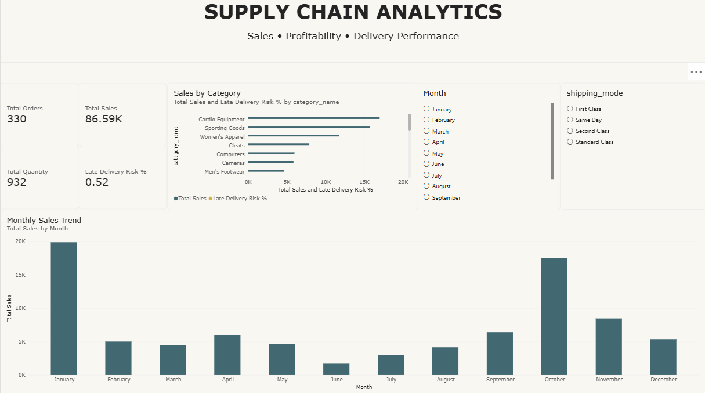

# 📦 Supply Chain & Order Fulfillment Analytics

> End-to-end data analysis of sales performance, product profitability, customer segments, and delivery risks using **Python**, **MySQL**, **Power BI**, and **Excel**.



---

## 📑 Table of Contents

1. [Overview & Business Problem](#overview--business-problem)
2. [Project Objectives](#project-objectives)
3. [Tools & Technologies](#tools--technologies)
4. [Dataset Description](#dataset-description)
5. [Data Cleaning & Preprocessing (Python)](#data-cleaning--preprocessing-python)
6. [SQL Analysis](#sql-analysis)
7. [Power BI Dashboard](#power-bi-dashboard)
8. [Key Performance Indicators (KPIs)](#key-performance-indicators-kpis)
9. [Project Folder Structure](#project-folder-structure)
10. [How to Run This Project Locally](#how-to-run-this-project-locally)
11. [Business Questions & Potential Recommendations](#business-questions--potential-recommendations)
12. [Limitations & Future Improvements](#limitations--future-improvements)
13. [Author](#author)

---

## Overview & Business Problem

Efficient supply chain management is critical for reducing costs, improving customer satisfaction, and maximizing profitability. Organizations often struggle to identify:

- Which product categories drive the most revenue vs. profit.
- Which customer segments are the most valuable.
- Where delivery delays create customer-experience risks.
- How seasonal trends affect order volume and revenue.

This project analyzes a retail supply chain dataset to uncover actionable insights across **sales trends**, **product profitability**, **customer segmentation**, and **delivery risk**, helping stakeholders make data-driven decisions.

---

## Project Objectives

| # | Objective |
|---|-----------|
| 1 | Quantify total orders, order items, and overall sales revenue. |
| 2 | Identify monthly and seasonal sales trends. |
| 3 | Evaluate product category performance by revenue and profit. |
| 4 | Segment customers (Consumer, Corporate, Home Office) and compare their contribution. |
| 5 | Assess delivery risk across shipping modes. |
| 6 | Detect low-profitability or loss-making products. |
| 7 | Perform data quality checks — missing values, duplicates, and data-type validation. |

---

## Tools & Technologies

| Tool | Purpose |
|------|---------|
| **Python** (pandas, NumPy) | Data cleaning, standardization, validation, and quality reports. |
| **MySQL** | Structured querying — aggregations, trend analysis, profitability calculations. |
| **Power BI** | Interactive dashboard with KPI cards, bar charts, trend lines, and slicers. |
| **Excel** | Optional initial data inspection before programmatic cleaning. |
| **Git / GitHub** | Version control and portfolio hosting. |

---

## Dataset Description

The dataset originates from a retail supply chain and contains **~180,000 order-item rows**. Each row represents a single **order item** — one product within a customer's order. A single `order_id` can appear in multiple rows when an order contains more than one product.

### Schema Highlights

| Column Group | Key Columns | Notes |
|--------------|-------------|-------|
| **Orders** | `order_id`, `order_item_id`, `order_date_dateorders`, `order_status` | `order_id` is **not** unique per row; `order_item_id` identifies individual line items. |
| **Sales & Profit** | `sales`, `order_item_total`, `order_profit_per_order`, `benefit_per_order`, `order_item_profit_ratio` | See ⚠️ aggregation warning below. |
| **Products** | `product_name`, `category_name`, `product_price`, `order_item_quantity` | `product_card_id` serves as a product identifier. |
| **Delivery** | `delivery_status`, `late_delivery_risk`, `days_for_shipping_real`, `days_for_shipment_scheduled`, `shipping_mode` | `late_delivery_risk` is a **binary risk indicator** (0 or 1), not a record of actual late delivery. |
| **Customers** | `customer_segment`, `customer_id`, `customer_city`, `customer_country` | Three segments: Consumer, Corporate, Home Office. |
| **Geography** | `market`, `order_region`, `order_country` | Markets include Africa, Europe, LATAM, Pacific Asia, USCA. |
| **Other** | `department_name`, `order_item_discount`, `order_item_discount_rate` | Discount rate is expressed as a decimal (0–1). |

> [!WARNING]
> **Aggregation caution — `order_profit_per_order` & `benefit_per_order`:**
> These columns store an **order-level** value that is **repeated on every item row** belonging to that order. Summing them directly across all rows will overcount profit. Before aggregating, validate whether these fields should be deduplicated to one row per `order_id`, or use `DISTINCT` / group-level logic.

> [!IMPORTANT]
> **Privacy notice:** Personal customer fields (`customer_email`, `customer_password`, `customer_fname`, `customer_lname`, `customer_street`) have been **dropped** during data cleaning or at the MySQL stage. These columns must never appear in public outputs, dashboards, or shared datasets.

> [!NOTE]
> **Scope boundary:** This dataset does **not** contain inventory levels, stock-on-hand, reorder points, or supplier information. Therefore, this project does not analyze stockouts, inventory turnover, or supplier performance.

---

## Data Cleaning & Preprocessing (Python)

All cleaning is performed in [`python/01_data_cleaning.ipynb`](python/01_data_cleaning.ipynb) using `pandas` and `NumPy`.

### Steps Performed

| Step | Description | Output |
|------|-------------|--------|
| **1. Column Standardization** | Converted all column names to lowercase `snake_case` using regex. Verified no duplicate column names were created. | Standardized DataFrame |
| **2. Date Conversion** | Parsed `order_date_dateorders` and `shipping_date_dateorders` to `datetime` format with mixed-format handling. | [`reports/date_conversion_report.csv`](reports/date_conversion_report.csv) — 0 failed conversions across 180,519 rows. |
| **3. Missing Value Audit** | Generated a column-level missing-value report. | [`reports/missing_values_report.csv`](reports/missing_values_report.csv) — `product_description` is 100% null; `order_zipcode` is 86% null; other columns are complete. |
| **4. Duplicate Detection** | Identified and removed exact duplicate rows (all columns identical). Did **not** remove rows where only `order_id` repeats (multi-item orders are expected). | [`reports/duplicate_records_for_review.csv`](reports/duplicate_records_for_review.csv) |
| **5. Numeric Validation** | Validated business-critical numeric columns (`sales`, `order_profit_per_order`, `order_item_quantity`, etc.) for type-correctness, negative values, and zeros. | [`reports/numeric_validation_report.csv`](reports/numeric_validation_report.csv) — 33,784 negative profit values and 1,177 zero-profit values flagged. |
| **6. Business-Rule Flagging** | Flagged (not deleted) rows with negative sales, non-positive quantities, discount rates outside 0–1, or invalid `late_delivery_risk` values. | [`reports/records_for_review.csv`](reports/records_for_review.csv) |
| **7. Export** | Saved the cleaned dataset as `data/cleaned_supply_chain.csv`. | [`data/cleaned_supply_chain.csv`](data/cleaned_supply_chain.csv) |

### Python Libraries Used

```
pandas >= 1.5
numpy >= 1.23
```

---

## SQL Analysis

All queries are in [`sql/supply.sql`](sql/supply.sql) and run against the `supply_chain_analysis` database, table `supply_chain`.

> [!NOTE]
> The SQL queries below are **ready to run**. Actual numeric results are not hardcoded here — run each query against your own database to generate findings.

### Q1 — Dataset Overview & Record Counts

```sql
SELECT
    COUNT(*)                       AS total_order_items,
    COUNT(DISTINCT order_id)       AS total_orders,
    COUNT(DISTINCT order_item_id)  AS distinct_order_items,
    COUNT(DISTINCT product_card_id) AS distinct_products,
    COUNT(DISTINCT customer_id)    AS distinct_customers,
    MIN(order_date_dateorders)     AS first_order_date,
    MAX(order_date_dateorders)     AS last_order_date
FROM supply_chain;
```

**Purpose:** Establish baseline record counts and date range. Distinguishes total rows (order items) from distinct orders.

---

### Q2 — Data Quality: Missing Values

```sql
SELECT
    COUNT(*)                                AS total_rows,
    SUM(order_id IS NULL)                   AS missing_order_ids,
    SUM(order_item_id IS NULL)              AS missing_item_ids,
    SUM(order_date_dateorders IS NULL)       AS missing_order_dates,
    SUM(sales IS NULL)                      AS missing_sales,
    SUM(order_item_quantity IS NULL)         AS missing_quantities,
    SUM(delivery_status IS NULL)            AS missing_delivery_status
FROM supply_chain;
```

**Purpose:** Verify data completeness for critical fields directly in MySQL.

---

### Q3 — Duplicate Order-Item Check

```sql
SELECT
    order_item_id,
    COUNT(*) AS occurrences
FROM supply_chain
GROUP BY order_item_id
HAVING COUNT(*) > 1
ORDER BY occurrences DESC;
```

**Purpose:** Identify if any `order_item_id` appears more than once (potential duplicates vs. legitimate multi-row entries).

---

### Q4 — Monthly Sales Trends

```sql
SELECT
    DATE_FORMAT(order_date_dateorders, '%Y-%m') AS order_month,
    ROUND(SUM(sales), 2)                       AS total_sales,
    ROUND(SUM(order_profit_per_order), 2)      AS total_profit,
    ROUND(
        100.0 * SUM(order_profit_per_order)
        / NULLIF(SUM(sales), 0), 2
    )                                           AS profit_margin_pct,
    COUNT(DISTINCT order_id)                   AS total_orders
FROM supply_chain
GROUP BY DATE_FORMAT(order_date_dateorders, '%Y-%m')
ORDER BY order_month;
```

**Purpose:** Detect seasonality, revenue trends, and profit-margin fluctuations over time.

> ⚠️ `order_profit_per_order` may be repeated across item rows within the same order. Validate before treating the summed profit as exact.

---

### Q5 — Product Category Performance

```sql
SELECT
    category_name,
    COUNT(DISTINCT order_id)             AS total_orders,
    SUM(order_item_quantity)             AS units_sold,
    ROUND(SUM(sales), 2)                AS total_sales,
    ROUND(SUM(order_profit_per_order), 2) AS total_profit
FROM supply_chain
GROUP BY category_name
ORDER BY total_profit DESC;
```

**Purpose:** Rank categories by sales and profit to identify top performers and underperformers.

---

### Q6 — Delivery Status Breakdown

```sql
SELECT
    delivery_status,
    COUNT(*)                AS order_item_rows,
    COUNT(DISTINCT order_id) AS affected_orders,
    ROUND(
        100.0 * COUNT(*)
        / (SELECT COUNT(*) FROM supply_chain), 2
    )                       AS pct_of_item_rows
FROM supply_chain
GROUP BY delivery_status
ORDER BY order_item_rows DESC;
```

**Purpose:** Understand the distribution of delivery outcomes (Advance Shipping, Late Delivery, Shipping Canceled, Shipping On Time).

---

### Q7 — Shipping Mode & Late Delivery Risk

```sql
SELECT
    shipping_mode,
    COUNT(*)                             AS total_items,
    SUM(late_delivery_risk = 1)          AS items_flagged_at_risk,
    ROUND(
        100.0 * SUM(late_delivery_risk = 1)
        / NULLIF(COUNT(*), 0), 2
    )                                    AS risk_rate_pct,
    ROUND(AVG(days_for_shipping_real), 2)      AS avg_actual_shipping_days,
    ROUND(AVG(days_for_shipment_scheduled), 2) AS avg_scheduled_shipping_days
FROM supply_chain
GROUP BY shipping_mode
ORDER BY risk_rate_pct DESC;
```

**Purpose:** Compare shipping modes by late-delivery risk rate and average fulfillment time.

> ℹ️ `late_delivery_risk` is a **predictive risk indicator** (1 = flagged at risk, 0 = not flagged). It does not confirm that a delivery was actually late.

---

### Q8 — Customer Segment Analysis

```sql
SELECT
    customer_segment,
    COUNT(DISTINCT order_id)   AS total_orders,
    COUNT(DISTINCT customer_id) AS unique_customers,
    ROUND(SUM(sales), 2)       AS total_sales,
    ROUND(SUM(order_profit_per_order), 2) AS total_profit,
    ROUND(
        SUM(sales) / NULLIF(COUNT(DISTINCT order_id), 0), 2
    )                          AS sales_per_order
FROM supply_chain
GROUP BY customer_segment
ORDER BY total_sales DESC;
```

**Purpose:** Compare Consumer, Corporate, and Home Office segments by order count, revenue, and average order value.

---

### Q9 — Bottom 10 Products by Profit Margin

```sql
SELECT
    product_name,
    category_name,
    SUM(order_item_quantity)              AS units_sold,
    ROUND(SUM(sales), 2)                 AS total_sales,
    ROUND(SUM(order_profit_per_order), 2) AS total_profit,
    ROUND(
        100.0 * SUM(order_profit_per_order)
        / NULLIF(SUM(sales), 0), 2
    )                                     AS profit_margin_pct
FROM supply_chain
GROUP BY product_name, category_name
HAVING SUM(sales) > 0
ORDER BY profit_margin_pct ASC
LIMIT 10;
```

**Purpose:** Identify products with the lowest (or negative) profit margins for pricing or procurement review.

---

### Q10 — Profit Field Inspection (Validation)

```sql
SELECT
    order_id, order_item_id, product_name,
    order_item_quantity, order_item_product_price,
    order_item_discount, sales, order_item_total,
    order_profit_per_order, benefit_per_order,
    order_item_profit_ratio
FROM supply_chain
LIMIT 20;
```

**Purpose:** Manually inspect order-level vs. item-level profit columns to determine aggregation logic.

---

## Power BI Dashboard

The interactive dashboard is saved in [`powerbi/suppy_chain.pbix`](powerbi/suppy_chain.pbix).

### Dashboard Features

| Component | Description |
|-----------|-------------|
| **KPI Cards** | Total Orders, Total Sales, Total Quantity, Late Delivery Risk %. |
| **Sales by Category** | Horizontal bar chart showing total sales and late delivery risk % by product category. |
| **Monthly Sales Trend** | Bar chart displaying total sales by month to visualize seasonality. |
| **Month Slicer** | Filter all visuals by selecting specific months (January–December). |
| **Shipping Mode Slicer** | Filter by First Class, Same Day, Second Class, Standard Class. |

### Dashboard Screenshot


> [!TIP]
> **Adding more screenshots:** Save additional dashboard screenshots (e.g., filtered views, drill-through pages) to the `screenshots/` folder and reference them here:
> ```markdown
> 
> ```

---

## Key Performance Indicators (KPIs)

| KPI | Definition | Granularity |
|-----|------------|-------------|
| **Total Orders** | `COUNT(DISTINCT order_id)` | One count per unique order. |
| **Total Order Items** | `COUNT(*)` from the full table. | One count per row (item-level). |
| **Total Sales** | `SUM(sales)` — revenue from all order items. | Item-level; safe to sum directly. |
| **Total Quantity** | `SUM(order_item_quantity)` — units sold. | Item-level. |
| **Late Delivery Risk %** | `SUM(late_delivery_risk) / COUNT(*)` | Proportion of item-rows flagged at risk. **Not** the actual late delivery rate. |
| **Profit Margin %** | `SUM(order_profit_per_order) / SUM(sales) × 100` | ⚠️ Requires validation — profit may be duplicated across item rows. |
| **Sales per Order** | `SUM(sales) / COUNT(DISTINCT order_id)` | Average revenue per order. |

---

## Project Folder Structure

```
supply-chain-analytics/
│
├── data/
│   ├── DataCoSupplyChainDataset.csv       # Original raw dataset
│   ├── DescriptionDataCoSupplyChain.csv   # Column descriptions / data dictionary
│   └── cleaned_supply_chain.csv           # Output of Python cleaning pipeline
│
├── python/
│   └── 01_data_cleaning.ipynb             # Jupyter notebook — cleaning & validation
│
├── sql/
│   └── supply.sql                         # All MySQL analysis queries
│
├── powerbi/
│   └── suppy_chain.pbix                   # Power BI dashboard file
│
├── excel/                                 # (Optional) Excel inspection files
│
├── reports/
│   ├── missing_values_report.csv          # Missing-value audit per column
│   ├── duplicate_records_for_review.csv   # Exact duplicate rows (if any)
│   ├── numeric_validation_report.csv      # Numeric field validation results
│   ├── date_conversion_report.csv         # Date parsing success/failure counts
│   └── records_for_review.csv            # Rows flagged by business-rule checks
│
├── screenshots/
│   └── Dashboard.png                      # Power BI dashboard screenshot
│
└── README.md                              # This file
```

---

## How to Run This Project Locally

### Prerequisites

- **Python 3.8+** with `pandas` and `numpy` installed
- **MySQL 8.0+** (or compatible MariaDB)
- **Power BI Desktop** (Windows) to open the `.pbix` file
- **Jupyter Notebook** or **VS Code** with the Jupyter extension

### Step 1 — Clone the Repository

```bash
git clone https://github.com/Bhushan3253/supply-chain-analytics.git
cd supply-chain-analytics
```

### Step 2 — Run the Python Cleaning Notebook

```bash
pip install pandas numpy
```

Open `python/01_data_cleaning.ipynb` in Jupyter Notebook or VS Code, update the `INPUT_FILE` path to point to your local copy of the raw CSV, and run all cells. The notebook will:

1. Standardize column names.
2. Convert date columns.
3. Audit missing values and duplicates.
4. Validate numeric fields.
5. Export `data/cleaned_supply_chain.csv` and quality reports to `reports/`.

### Step 3 — Set Up MySQL and Import the Cleaned CSV

```sql
-- Create the database and table
CREATE DATABASE supply_chain_analysis;
USE supply_chain_analysis;
```

Import `data/cleaned_supply_chain.csv` into the `supply_chain` table using one of:

**Option A — MySQL Workbench:** Use the **Table Data Import Wizard** (right-click the table → Table Data Import Wizard → select the CSV).

**Option B — Command line:**

```sql
LOAD DATA LOCAL INFILE '/path/to/cleaned_supply_chain.csv'
INTO TABLE supply_chain
FIELDS TERMINATED BY ','
ENCLOSED BY '"'
LINES TERMINATED BY '\n'
IGNORE 1 ROWS;
```

> [!NOTE]
> Adjust the file path separator for your operating system. On Windows, use forward slashes or escaped backslashes in the path.

Then drop personal customer information if not already removed:

```sql
ALTER TABLE supply_chain DROP COLUMN customer_email;
ALTER TABLE supply_chain DROP COLUMN customer_password;
```

### Step 4 — Run SQL Queries

Open [`sql/supply.sql`](sql/supply.sql) in MySQL Workbench or any SQL client and execute the queries sequentially.

### Step 5 — Open the Power BI Dashboard

Open `powerbi/suppy_chain.pbix` in Power BI Desktop. If prompted, update the data source connection to point to your local MySQL instance or the cleaned CSV.

---

## Business Questions & Potential Recommendations

> [!IMPORTANT]
> The recommendations below are **hypothetical directions** to explore once actual query results are available. They are **not** verified findings.

| Business Question | Analysis Approach | Potential Recommendation Area |
|-------------------|-------------------|-------------------------------|
| Which months drive the most revenue? | Monthly sales trend (Q4) | Align promotions and inventory planning with peak months. |
| Which product categories are most profitable? | Category performance (Q5) | Increase investment in high-margin categories; review pricing on low-margin ones. |
| Are certain shipping modes riskier? | Shipping mode risk analysis (Q7) | Evaluate whether cost savings from cheaper modes offset customer-satisfaction risk. |
| Which customer segment has the highest sales per order? | Segment analysis (Q8) | Tailor marketing campaigns by segment (e.g., Corporate bulk discounts). |
| Which products are losing money? | Bottom 10 products (Q9) | Consider repricing, bundling, or discontinuing loss-making products. |
| Is the late-delivery risk rate acceptable? | Delivery status breakdown (Q6) | Investigate root causes for high-risk routes or shipping modes. |

---

## Limitations & Future Improvements

### Current Limitations

- **No inventory or supplier data:** The dataset does not include stock-on-hand, reorder points, supplier lead times, or warehouse information. Analyses such as stockout detection, inventory turnover, and supplier performance are **out of scope**.
- **`order_profit_per_order` duplication:** This order-level metric repeats across item rows. Aggregations using this field require careful deduplication to avoid overcounting.
- **`late_delivery_risk` is predictive:** The column indicates *risk of* late delivery, not confirmed late delivery. It should not be used to calculate actual on-time delivery rates.
- **Static dataset:** The analysis is a point-in-time snapshot and does not refresh automatically.
- **No customer demographics:** Age, income, and purchase-history depth are not available for advanced segmentation.

### Future Improvements

- [ ] Create item-level profit columns to enable accurate item-level profitability analysis.
- [ ] Build a date dimension table for advanced time-intelligence (YoY, QoQ comparisons) in Power BI.
- [ ] Add geographic visualizations (map charts) for regional sales and delivery patterns.
- [ ] Integrate with a live database for auto-refreshing dashboards.
- [ ] Perform RFM (Recency, Frequency, Monetary) customer segmentation.
- [ ] Conduct statistical testing on delivery performance across shipping modes.
- [ ] Add Python-based exploratory data analysis (EDA) with visualizations (matplotlib / seaborn).

---

## Author

| | |
|---|---|
| **Name** | *Your Name* |
| **LinkedIn** | [linkedin.com/in/your-profile](https://linkedin.com/in/your-profile) |
| **GitHub** | [github.com/Bhushan3253](https://github.com/Bhushan3253) |
| **Portfolio** | *your-portfolio-url* |

> 📌 *Replace the placeholders above with your actual name, LinkedIn URL, and portfolio link.*

---

## 📄 License

This project is for educational and portfolio purposes.

---

<p align="center">
  <i>If you found this project helpful, consider giving it a ⭐ on GitHub!</i>
</p>
